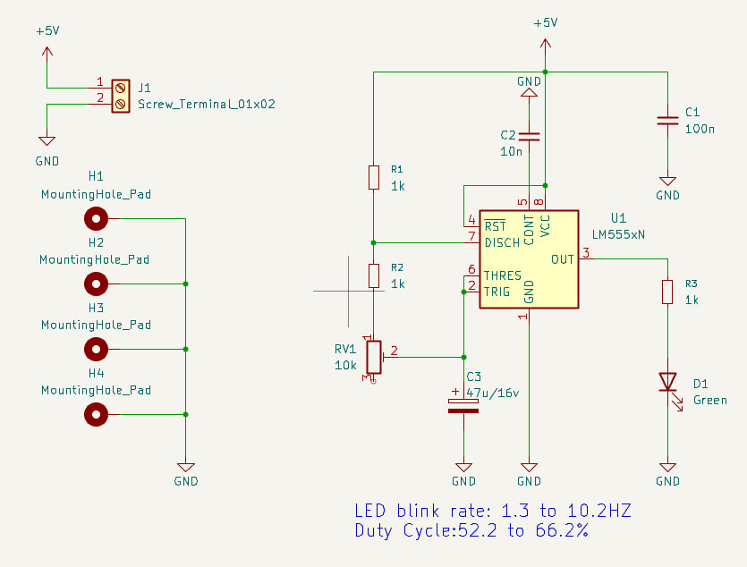
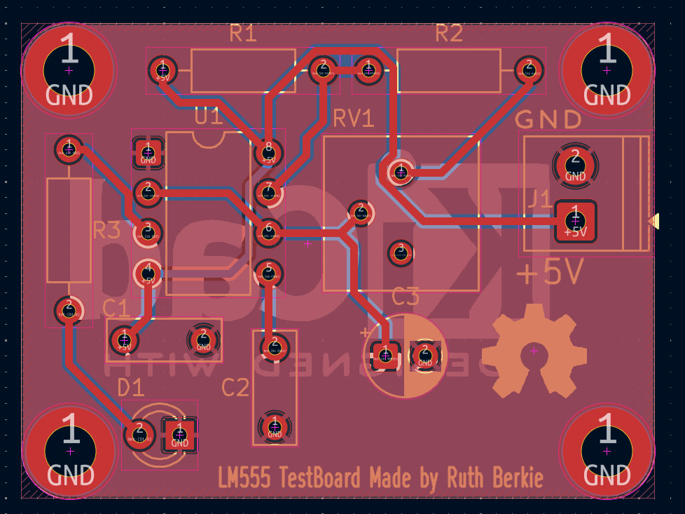
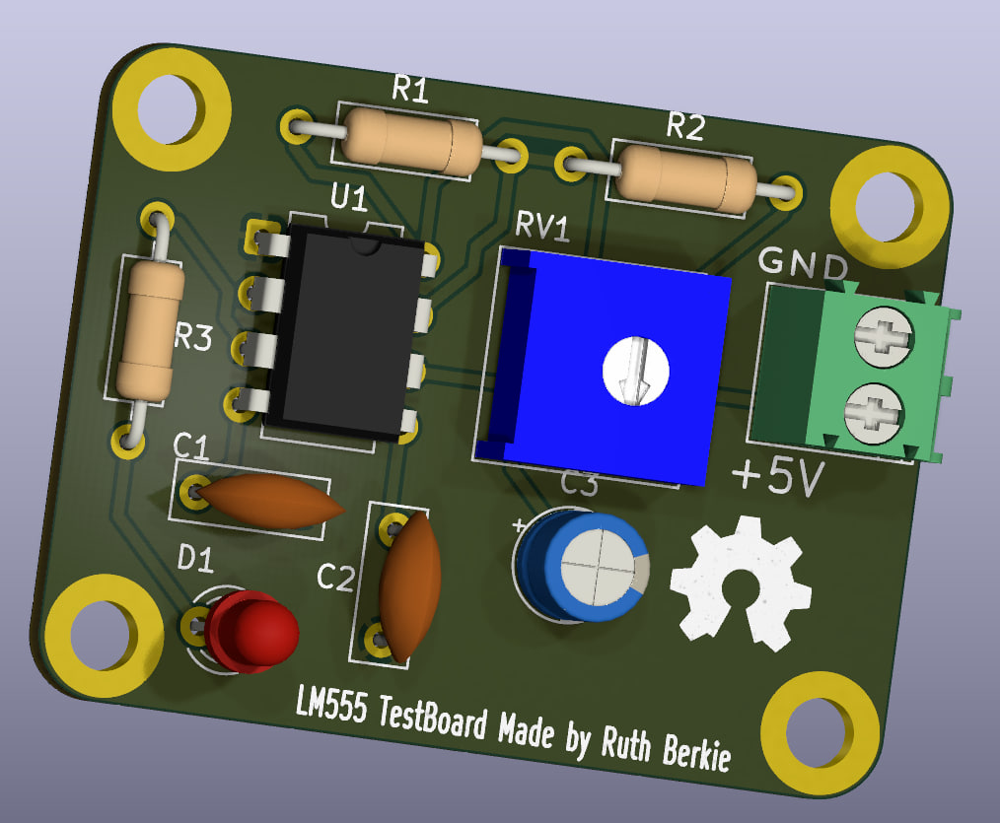

This schematic design is an adjustable LED flasher circuit configured as an astable multivibrator using the classic 555 timer IC. It automatically generates a continuous stream of square-wave pulses, causing the green LED to blink repeatedly at a speed (frequency) that can manually be tuned.

Component Breakdown & Functions

Core Integrated Circuit

    • U1 (LM555xN): The main 555 timer IC. It acts as an electronic oscillator that continuously switches its output pin between HIGH (+5V) and LOW (0V) states.
    
• Pin 1 — GND (Ground): This serves as the universal reference point (0V) for the entire circuit. It connects directly to the negative terminal of your power supply to complete the electrical circuit loop.

• Pin 2 — TRIG (Trigger): This acts as the "Turn On" switch for the chip's output. Whenever the electrical voltage on this specific pin drops below 1/3 of your main power supply voltage, it forces the chip's primary output (Pin 3) to flip into a HIGH state.

• Pin 3 — OUT (Output): This is the power driver where the chip delivers its finalized timing signal. It is robust enough to push or pull up to 200mA of electric current, making it ideal for directly powering external components like flashing LEDs, audible buzzers, or switching relays.

• Pin 4 — RESET (Reset): This functions as a master system override. Applying a LOW voltage (0V) to this pin immediately cuts off the system and forces the output (Pin 3) to turn off. In regular circuit configurations, it is tied directly to the positive power supply (+VCC) so the chip doesn’t experience accidental resets from stray static.

• Pin 5 — CONT (Control Voltage): This behaves as a threshold tuner by giving you external access to the internal voltage divider network. In standard projects, designers attach a tiny capacitor here to isolate the chip from external electrical noise and keep the overall timing steady.

• Pin 6 — THRES (Threshold): This serves as the "Turn Off" switch for the output. When the voltage charging up on this pin rises past 2/3 of your main power supply voltage, it trips the internal mechanics and forces the output (Pin 3) to flip LOW, successfully ending that specific pulse cycle.

• Pin 7 — DISCH (Discharge): This is the dedicated capacitor drain. Internally, it is connected to a microscopic transistor switch. When the main output flips to a LOW state, this pin activates a direct connection to GND, allowing your timing capacitor an easy path to empty its stored energy.

• Pin 8 — VCC (Voltage Common Collector): This is the main power input for the integrated circuit. It connects directly to the positive terminal of your power supply. For standard 555 models, it safely accepts a wide power range, typically anywhere from +4.5V up to +16V.

    • Pins 2 and 6 are tied together: This forces the chip to continuously watch its own timing capacitor. As the capacitor charges up past the Threshold (Pin 6) limit, the chip shuts off the output. As the capacitor drains down past the Trigger (Pin 2) limit, the chip turns the output back on.
    • Pin 7 manages the timing speed: It opens and closes the drainage path, causing the capacitor to cycle up and down based on the resistance of your potentiometer.

Power & Support Elements

    • J1 (Screw_Terminal_01x02): A 2-pin terminal block. It serves as the main power input connection point to hook up an external 5V power supply and ground.
    • C1 (100n): A 100nF ceramic decoupling capacitor. It sits across the power rails to filter out high-frequency electrical noise and stabilize the incoming 5V supply.
    • C2 (10n): A 10nF bypass capacitor connected to the Control Voltage pin (Pin 5). It prevents stray electrical noise from interfering with the internal voltage references of the timer.
    • H1, H2, H3, H4 (MountingHole_Pad): Mechanical mounting holes for securing the physical circuit board with screws. They are connected to GND to provide a clean grounding path or shielding.

Timing Network (Frequency Control)

    • C3 (47u/16v): A 47µF polarized electrolytic timing capacitor. This component continuously charges and discharges to dictate the time duration of the ON and OFF states.
    • The Upper Threshold (2/3 of VCC): 3.33V. When the timing capacitor C3 charges up from zero and hits this exact voltage, Pin 6 (Threshold) triggers the 555 chip to turn the green LED OFF and begin discharging.
    • The Lower Trigger (1/3 of VCC): 1.67V. As the capacitor C3 empties its energy into Pin 7, the voltage drops. The moment it falls to this exact voltage, Pin 2 (Trigger) trips the chip to turn the green LED back ON and start the charging cycle all over again.
    
    In short, your capacitor C3 will continuously bounce back and forth between 1.67V and 3.33V forever while the circuit is powered.

    • R1 (1k): A 1kΩ fixed resistor. It controls the charging rate and prevents a direct short-circuit between the +5V power supply and ground when the IC activates its internal discharge pin (Pin 7).
    • R2 (1k): A 1kΩ fixed resistor. It sets a minimum safety baseline resistance for the timing network so that even if the potentiometer is dialed down to zero, the circuit won't malfunction.
    • RV1 (10k): A 10kΩ variable resistor (potentiometer). Turning this dial changes the overall resistance of the timing path, allowing you to speed up or slow down how fast C3 charges and discharges, which changes the LED blink rate.
    
Output Elements

    • R3 (1k): A 1kΩ current-limiting resistor. It protects the LED from receiving too much current from the output pin (Pin 3), preventing it from burning out.
    • D1 (Green): A green Light Emitting Diode. It flashes on and off visually to show the output pulses generated by the 555 timer.

    

 
How the Circuit Works

    1. The Charging Phase: Current flows from +5V through R1, R2, and RV1 to charge the capacitor C3. While it charges, the output (Pin 3) stays HIGH (+5V), turning the green LED ON.
    2. The Threshold Trigger: Once the voltage across C3 reaches 2/3 of the supply voltage, the 555 timer trips internally. The output (Pin 3) flips to LOW (0V), turning the green LED OFF, and Pin 7 internally connects to ground.
    3. The Discharging Phase: The energy stored in C3 begins draining backward through RV1 and R2 directly into the discharge pin (Pin 7).
    4. The Reset Trigger: As soon as the voltage across C3 drops down to 1/3 of the supply voltage, the timer trips again. Pin 7 closes its connection to ground, the output goes back to HIGH, the LED turns ON, and the loop starts all over again.

FINAL RESULT

   
